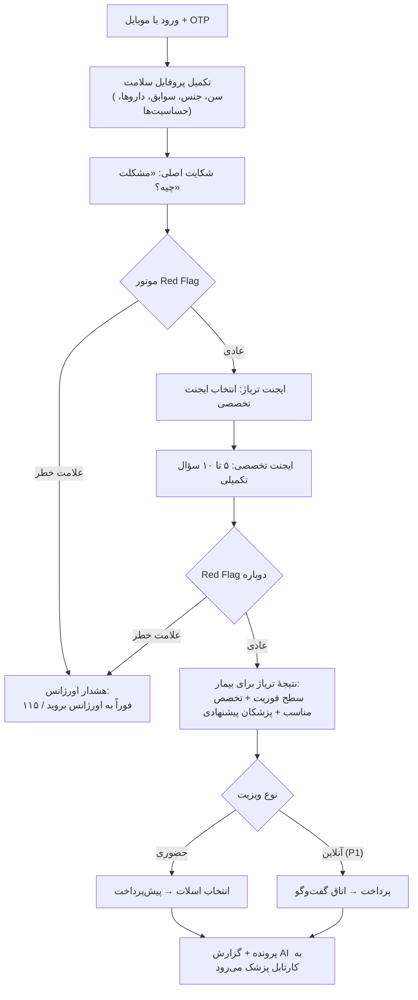

# سند نیازمندی‌های محصول (PRD) — [نام محصول]

**مارکت‌پلیس پزشکی با پیش‌پذیرش هوشمند (AI-assisted Pre-visit Triage)**

| مورد | مقدار |
|---|---|
| نسخه | 0.1 (پیش‌نویس MVP) |
| تاریخ | مهر ۱۴۰۵ |
| وضعیت | پیش‌نویس برای بازبینی |
| سند مرتبط | [SRS.md](./SRS.md) — مشخصات فنی و نیازمندی‌های نرم‌افزار |

> ❓ **تصمیم باز:** نام محصول هنوز انتخاب نشده؛ در کل سند از «[نام محصول]» استفاده شده است.

---

## ۱. خلاصهٔ اجرایی

[نام محصول] یک مارکت‌پلیس پزشکی (Marketplace) شبیه پذیرش۲۴ و نوبت‌دات‌آی‌آر است که یک لایهٔ **پیش‌پذیرش هوشمند** به آن اضافه می‌کند:

1. **بیمار** پروفایل سلامت و علائمش را وارد می‌کند (فرم هدایت‌شده + گفت‌وگو).
2. **ایجنت‌های تخصصی هوش مصنوعی** (Specialist Agents) — به جای یک چت‌بات عمومی — علائم را با پروتکل همان تخصص بررسی می‌کنند و سؤالات تکمیلی می‌پرسند.
3. بیمار فقط **تریاژ** می‌بیند: سطح فوریت، تخصص مناسب و پزشکان پیشنهادی. **تشخیص به بیمار نمایش داده نمی‌شود.**
4. وقتی بیمار نوبت می‌گیرد، پرونده به **کارتابل پزشک** می‌رود؛ آنجا AI می‌گوید: *«بر اساس علائم دریافتی، تشخیص‌های محتمل من این‌هاست…»* همراه با خلاصهٔ بالینی، سؤالات پیشنهادی و آزمایش‌های پیشنهادی.
5. پزشک تشخیص AI را **تأیید / ویرایش / رد** می‌کند؛ این بازخورد کیفیت AI را در طول زمان بالا می‌برد.
6. پزشکان می‌توانند با **پلن‌های پروموت** دیده‌شدن خود را افزایش دهند.

پنل بیمار و پنل پزشک دو اپلیکیشن جدا هستند و یک پنل ادمین حداقلی هم برای اپراتور پلتفرم وجود دارد.

---

## ۲. مسئله

| ذی‌نفع | مسئله |
|---|---|
| بیمار | نمی‌داند با این علائم باید پیش کدام متخصص برود؛ اغلب اول پیش پزشک اشتباه می‌رود و وقت و هزینه تلف می‌کند. نمی‌داند علائمش اورژانسی است یا نه. |
| پزشک | بخش بزرگی از زمان ویزیت صرف شرح‌حال‌گیری (History Taking) تکراری می‌شود؛ بیمار اطلاعات را ناقص و نامرتب می‌گوید. |
| پزشک جدید / کم‌شناخته | در پلتفرم‌های فعلی رتبه‌بندی بر اساس سابقه و نظرات است و دیده‌شدن برایش سخت است. |
| پلتفرم‌های فعلی | فقط «دفترچهٔ تلفن + تقویم» هستند؛ ارزش بالینی اضافه‌ای به بیمار یا پزشک نمی‌دهند. |

---

## ۳. پرسوناها

**بیمار — «سارا، ۳۴ ساله، کارمند، تهران»**
چند روز است سرگیجه و تپش قلب دارد. نمی‌داند باید پیش متخصص قلب برود یا گوش‌وحلق‌وبینی یا اعصاب. با موبایل کار می‌کند و حوصلهٔ فرم طولانی ندارد.

**پزشک متخصص — «دکتر رضایی، متخصص داخلی، ۸ سال سابقه»**
مطب شلوغ دارد. می‌خواهد قبل از ورود بیمار بداند مشکل چیست، و دوست دارد ویزیت آنلاین هم داشته باشد. به AI بدبین است و فقط ابزاری را قبول می‌کند که وقتش را بگیرد نه اینکه جای او تصمیم بگیرد.

**پزشک جوان — «دکتر احمدی، متخصص پوست، تازه مطب زده»**
بیمار کم دارد و حاضر است برای دیده‌شدن هزینه کند.

**ادمین/اپراتور پلتفرم**
پزشکان را احراز هویت می‌کند، تخصص‌ها و قوانین هشدار را مدیریت می‌کند، کیفیت AI و تراکنش‌ها را پایش می‌کند.

---

## ۴. ارزش پیشنهادی و تمایز

| | پذیرش۲۴ / نوبت‌دات | [نام محصول] |
|---|---|---|
| انتخاب پزشک | جست‌وجوی دستی بر اساس تخصص | تریاژ AI → تخصص مناسب → پزشکان پیشنهادی (جست‌وجوی دستی هم هست) |
| تشخیص فوریت | ندارد | هشدار اورژانس قاعده‌محور + AI |
| آمادگی پزشک قبل از ویزیت | ندارد | خلاصهٔ بالینی ساختاریافته + تشخیص افتراقی + سؤالات پیشنهادی در کارتابل |
| دیده‌شدن پزشک | سابقه/نظرات | پروموت شفاف (برچسب‌دار) + پیشنهاد مبتنی بر تطابق تخصص |

**جملهٔ ارزش:** «قبل از اینکه بیمار وارد مطب شود، پزشک می‌داند با چه کسی و چه مشکلی روبه‌روست؛ و بیمار از اول پیش پزشک درست می‌رود.»

---

## ۵. اهداف و غیرهدف‌ها

### اهداف MVP
1. اثبات اینکه بیماران فرم/گفت‌وگوی علائم را کامل می‌کنند و به رزرو می‌رسند.
2. اثبات اینکه پزشکان خلاصهٔ AI را مفید می‌دانند (موافقت با تخصص پیشنهادی و استفاده از خلاصه).
3. راه‌اندازی چرخهٔ کامل درآمدی: رزرو، پرداخت، ویزیت آنلاین، پروموت.
4. جمع‌آوری دادهٔ بازخورد پزشک روی خروجی AI برای بهبود مدل‌ها.

### غیرهدف‌ها (در MVP نیست)
- **نمایش تشخیص AI به بیمار** (تصمیم محصول؛ فقط تریاژ).
- نسخهٔ الکترونیک و اتصال به سامانهٔ نسخه‌نویسی بیمه‌ها.
- بیمه‌های پایه و تکمیلی.
- اپلیکیشن نیتیو اندروید/iOS (MVP = وب ریسپانسیو/PWA).
- تماس صوتی/تصویری داخل پلتفرم (P2).
- تفسیر تصویر پزشکی یا جواب آزمایش توسط AI.
- نظرات و امتیازدهی بیماران (P2).

---

## ۶. دامنهٔ MVP و اولویت‌بندی

همهٔ قابلیت‌هایی که خواسته شده (نوبت حضوری، ویزیت آنلاین، پرداخت، پروموت) در MVP هستند، اما برای کاهش ریسک **در دو موج** عرضه می‌شوند:

| اولویت | معنی |
|---|---|
| **P0** | هستهٔ لانچ؛ بدون آن محصول معنی ندارد. موج اول. |
| **P1** | داخل MVP، ولی بعد از تثبیت هسته. موج دوم (حدود ۴ هفته بعد). |
| **P2** | بعد از MVP. |

| ماژول | قابلیت | اولویت |
|---|---|---|
| حساب کاربری | ورود/ثبت‌نام با موبایل و کد یک‌بارمصرف (OTP) برای بیمار و پزشک | P0 |
| پروفایل بیمار | اطلاعات پایه، سوابق بیماری، داروها، حساسیت‌ها، اعضای خانواده (پروفایل برای فرزند/والدین) | P0 |
| ثبت علائم | فرم هدایت‌شده + گفت‌وگوی AI برای سؤالات تکمیلی؛ آپلود عکس/مدرک (فقط برای پزشک، بدون تفسیر AI) | P0 |
| AI | موتور هشدار اورژانس قاعده‌محور (Red Flag) | P0 |
| AI | ایجنت تریاژ/مسیریاب + ایجنت‌های تخصصی | P0 |
| AI | ایجنت دستیار پزشک (خلاصه، تشخیص افتراقی، سؤال/آزمایش پیشنهادی) | P0 |
| کشف پزشک | پیشنهاد پزشک بعد از تریاژ + جست‌وجوی دستی (تخصص، شهر، نوع ویزیت) | P0 |
| پزشک | ثبت‌نام، احراز هویت (شمارهٔ نظام پزشکی + مدارک + تأیید ادمین)، پروفایل عمومی | P0 |
| پزشک | تقویم کاری، مطب‌ها، اسلات‌های نوبت | P0 |
| نوبت | رزرو، لغو، یادآوری پیامکی نوبت حضوری | P0 |
| کارتابل پزشک | لیست پرونده‌های ارجاعی با خلاصهٔ AI، ثبت بازخورد روی AI، ثبت یادداشت ویزیت | P0 |
| پرداخت | درگاه پرداخت (پیش‌پرداخت نوبت حضوری، هزینهٔ ویزیت آنلاین، خرید پلن پروموت)، بازپرداخت در لغو | P0 |
| ادمین | تأیید پزشک، مدیریت تخصص‌ها، مدیریت قوانین Red Flag، گزارش تراکنش‌ها | P0 |
| ویزیت آنلاین | گفت‌وگوی متنی بیمار–پزشک با ارسال فایل، زمان‌دار | P1 |
| پروموت | پلن‌های اشتراک پروموت، جایگاه «پیشنهاد ویژه» با برچسب «تبلیغ»، داشبورد بازدید | P1 |
| مالی پزشک | گزارش درآمد و درخواست تسویه | P1 |
| ادمین | داشبورد کیفیت AI (نرخ موافقت پزشکان) | P1 |
| ویزیت آنلاین | تماس صوتی/تصویری | P2 |
| اجتماعی | نظرات و امتیاز | P2 |

> ⚠️ **توجه:** گنجاندن همهٔ این‌ها در یک MVP دامنه را بزرگ می‌کند. پیشنهاد این است که موج اول (P0) زودتر با تعداد محدودی پزشک (مثلاً ۳۰–۵۰ پزشک در یک شهر) لانچ شود و P1 روی بازخورد واقعی ساخته شود.

---

## ۷. سفرهای کاربری (User Journeys)

### ۷.۱ بیمار — مسیر اصلی

**نکته:** بیمار در هر لحظه می‌تواند تریاژ را رد کند و مستقیم پزشک را جست‌وجو کند (مسیر بدون AI).

### ۷.۲ پزشک — مسیر اصلی
1. ثبت‌نام با موبایل → واردکردن شمارهٔ نظام پزشکی، تخصص، آپلود کارت نظام و مدارک.
2. ادمین بررسی و تأیید می‌کند (در MVP دستی؛ مقایسه با استعلام عمومی نظام پزشکی).
3. تکمیل پروفایل عمومی (عکس، بیوگرافی، مطب‌ها، تعرفه) و تنظیم تقویم.
4. نوبت جدید → اعلان → در کارتابل: خلاصهٔ بالینی، تشخیص‌های محتمل AI، سؤالات و آزمایش‌های پیشنهادی.
5. بعد یا حین ویزیت: تشخیص AI را **تأیید / ویرایش / رد** می‌کند و تشخیص نهایی خودش را ثبت می‌کند (اختیاری ولی تشویق‌شده).
6. (P1) خرید پلن پروموت و دیدن آمار بازدید پروفایل.

### ۷.۳ مسیر اورژانس
اگر هر یک از علائم خطر (مثل درد قفسهٔ سینه همراه با تنگی نفس، علائم سکته مغزی، خونریزی شدید، افکار خودکشی، تب بالا در نوزاد زیر ۳ ماه و …) شناسایی شود:
- پیام تمام‌صفحه و واضح: «این علائم ممکن است جدی باشد. همین حالا با ۱۱۵ تماس بگیرید یا به نزدیک‌ترین اورژانس بروید.» با دکمهٔ تماس مستقیم.
- مسیر رزرو عادی برای این گزارش غیرفعال می‌شود (بیمار می‌تواند بعداً گزارش جدید بسازد).
- برای افکار خودکشی: نمایش خط ملی اورژانس اجتماعی ۱۲۳ و صدای مشاور ۱۴۸۰.
- رویداد ثبت می‌شود (برای پایش ادمین).

---

## ۸. داستان‌های کاربری (User Stories) و معیار پذیرش

شناسهٔ نیازمندی‌های فنی متناظر در [SRS.md](./SRS.md) آمده است (ماتریس ردیابی در پیوست SRS).

### بیمار

**US-01 — ورود با موبایل (P0)**
به‌عنوان بیمار می‌خواهم فقط با شمارهٔ موبایل وارد شوم تا رمز یادم نرود.
- کد ۵ رقمی پیامک می‌شود، ۲ دقیقه اعتبار دارد، حداکثر ۵ تلاش.
- بعد از ورود، اگر پروفایل ناقص باشد به تکمیل پروفایل هدایت می‌شوم.

**US-02 — پروفایل سلامت (P0)**
به‌عنوان بیمار می‌خواهم یک بار سوابقم را وارد کنم تا هر بار تکرار نکنم.
- فیلدها: نام، تاریخ تولد، جنس، قد/وزن، بیماری‌های زمینه‌ای، داروهای مصرفی، حساسیت‌ها، سابقهٔ جراحی، بارداری (در صورت مرتبط بودن)، مصرف سیگار/الکل.
- می‌توانم برای فرزند یا والدینم پروفایل جدا بسازم و هنگام ثبت علائم انتخاب کنم «برای چه کسی».
- همهٔ فیلدها جز نام، تاریخ تولد و جنس اختیاری‌اند.

**US-03 — ثبت علائم (P0)**
به‌عنوان بیمار می‌خواهم مشکلم را به زبان خودم بگویم و سؤالات ساده جواب دهم.
- ابتدا متن آزاد «مشکلت چیه؟» + انتخاب سریع از علائم رایج (چیپ).
- سپس سؤالات تکمیلی یکی‌یکی، ترجیحاً چندگزینه‌ای (مدت، شدت ۱ تا ۱۰، محل، عوامل تشدید/تسکین، علائم همراه).
- حداکثر ۱۲ سؤال؛ نوار پیشرفت نمایش داده می‌شود.
- می‌توانم عکس/مدرک (جواب آزمایش، عکس ضایعهٔ پوستی) پیوست کنم؛ فقط پزشک آن را می‌بیند.
- پیش‌نویس ذخیره می‌شود و می‌توانم بعداً ادامه دهم.

**US-04 — نتیجهٔ تریاژ (P0)**
به‌عنوان بیمار می‌خواهم بدانم موضوع چقدر فوری است و پیش چه متخصصی بروم.
- نمایش: سطح فوریت (اورژانس / ظرف ۲۴ ساعت / ظرف چند روز / غیرفوری)، تخصص پیشنهادی + یک تخصص جایگزین، توضیح کوتاه و غیرتشخیصی («علائم شما بیشتر به حوزهٔ … مربوط است»).
- **هیچ نام بیماری یا تشخیصی نمایش داده نمی‌شود.**
- سلب مسئولیت: «این راهنما جایگزین نظر پزشک نیست.»
- زیر آن لیست پزشکان مرتبط (نزدیک‌ترین نوبت خالی، شهر، نوع ویزیت).

**US-05 — هشدار اورژانس (P0)** — مطابق بخش ۷.۳.

**US-06 — جست‌وجوی دستی پزشک (P0)**
فیلتر بر اساس تخصص، شهر، نوع ویزیت (حضوری/آنلاین)، جنسیت پزشک، نزدیک‌ترین نوبت.

**US-07 — رزرو نوبت حضوری (P0)**
- انتخاب مطب و اسلات خالی؛ اسلات تا ۱۰ دقیقه برای پرداخت قفل می‌شود.
- پس از پرداخت، تأیید پیامکی + یادآوری ۲۴ ساعت و ۲ ساعت قبل.
- انتخاب اینکه گزارش علائم با پزشک به اشتراک گذاشته شود (پیش‌فرض: بله، با رضایت صریح).

**US-08 — لغو و بازپرداخت (P0)**
- لغو تا X ساعت قبل از نوبت = بازپرداخت کامل به کیف پول/کارت؛ بعد از آن طبق سیاست پزشک.
> ❓ **تصمیم باز:** مقدار X و سیاست بازپرداخت.

**US-09 — ویزیت آنلاین متنی (P1)**
- پرداخت هزینه → اتاق گفت‌وگو با پزشک باز می‌شود؛ ارسال متن، عکس، PDF.
- پزشک باید ظرف زمان اعلام‌شده (مثلاً ۲ ساعت) پاسخ اول را بدهد؛ وگرنه بازپرداخت خودکار.
- گفت‌وگو ۷۲ ساعت باز می‌ماند یا تا زمانی که پزشک «پایان ویزیت» بزند.

**US-10 — تاریخچه (P0)**
لیست گزارش‌های علائم، نوبت‌ها و ویزیت‌ها، با یادداشت/توصیهٔ پزشک (هر چه پزشک برای بیمار منتشر کند).

### پزشک

**US-11 — ثبت‌نام و احراز هویت (P0)**
- ورود با OTP، فرم: نام، کد ملی، شمارهٔ نظام پزشکی، تخصص (و فوق‌تخصص)، آپلود کارت نظام و پروانهٔ مطب.
- تا تأیید ادمین، پروفایل عمومی نمایش داده نمی‌شود؛ وضعیت «در انتظار بررسی» دیده می‌شود.

**US-12 — پروفایل عمومی (P0)**
عکس، بیوگرافی، تخصص‌ها، زمینه‌های کاری (مثلاً «دیابت، تیروئید»)، مطب‌ها با آدرس و نقشه، تعرفهٔ ویزیت حضوری و آنلاین، زبان‌ها.

**US-13 — تقویم (P0)**
تعریف برنامهٔ هفتگی برای هر مطب (روز، ساعت، طول هر نوبت)، بستن روزهای خاص، ظرفیت ویزیت آنلاین روزانه.

**US-14 — کارتابل با خلاصهٔ AI (P0)**
به‌عنوان پزشک می‌خواهم قبل از ورود بیمار بدانم مشکلش چیست.
- لیست نوبت‌های امروز/آینده و پرونده‌های آنلاین، با برچسب فوریت.
- در هر پرونده:
  - مشخصات و سوابق بیمار (از پروفایل)،
  - **خلاصهٔ بالینی ساختاریافته** (شکایت اصلی، شرح بیماری فعلی، علائم مثبت/منفی مهم)،
  - **تشخیص‌های افتراقی AI** با عنوان «تشخیص AI بر اساس علائم دریافتی»، هر مورد با سطح احتمال (بالا/متوسط/پایین) و دلیل،
  - سؤالات پیشنهادی برای پرسیدن در ویزیت و آزمایش/معاینهٔ پیشنهادی،
  - پاسخ‌های خام بیمار (برای بررسی دقیق) و فایل‌های پیوست.
- برچسب واضح: «پیشنهاد هوش مصنوعی — تصمیم نهایی با پزشک است.»

**US-15 — بازخورد روی AI (P0)**
- برای هر تشخیص AI: ✓ موافق / ✎ ویرایش / ✗ مخالف؛ ثبت تشخیص نهایی (متن آزاد یا انتخاب از لیست کدهای ICD-10 پرکاربرد).
- امتیاز کلی مفید بودن خلاصه (۱ تا ۵).
- آیا تخصص پیشنهادی درست بود؟ (بله/خیر + تخصص درست).

**US-16 — پرسش از دستیار AI در پرونده (P1)**
پزشک می‌تواند در همان پرونده از AI سؤال کند («چه آزمایش‌هایی برای رد X لازم است؟»). پاسخ‌ها فقط به پزشک نمایش داده می‌شود.

**US-17 — ویزیت آنلاین سمت پزشک (P1)**
اعلان پرونده جدید، پاسخ متنی/فایل، قالب‌های پاسخ آماده، پایان ویزیت با نوشتن توصیه برای بیمار.

**US-18 — پروموت (P1)**
- خرید پلن ماهانه (مثلاً پایه / حرفه‌ای) با پرداخت آنلاین.
- مزایا: جایگاه «پیشنهاد ویژه» برچسب‌دار در نتایج تخصص خودش، نشان «پزشک ویژه» در پروفایل، اولویت در نتایج جست‌وجوی دستی (با برچسب)، داشبورد آمار (بازدید پروفایل، کلیک، رزرو).
- قانون اعتماد: پروموت **روی خروجی تریاژ AI (تخصص پیشنهادی و فوریت) هیچ اثری ندارد** و فقط در جایگاه جداگانهٔ برچسب‌دار ظاهر می‌شود.

**US-19 — مالی (P1)**
گزارش ویزیت‌ها، درآمد، کمیسیون پلتفرم، درخواست تسویه.

### ادمین

**US-20 — تأیید پزشک (P0)**: صف درخواست‌ها، مشاهدهٔ مدارک، تأیید/رد با دلیل، تعلیق پزشک.
**US-21 — تنظیمات پایه (P0)**: مدیریت تخصص‌ها، شهرها، قوانین Red Flag (افزودن/ویرایش با ثبت تاریخچه)، پلن‌های پروموت و قیمت‌ها، درصد کمیسیون.
**US-22 — پایش (P0/P1)**: گزارش تراکنش‌ها و بازپرداخت‌ها (P0)، داشبورد کیفیت AI و رویدادهای اورژانس (P1).

---

## ۹. اصول هوش مصنوعی و ایمنی بالینی

1. **پزشک تصمیم‌گیرنده است (Human-in-the-loop).** AI فقط پیشنهاد می‌دهد؛ هیچ خروجی AI بدون واسطهٔ پزشک به‌عنوان تشخیص یا درمان به بیمار نمی‌رسد.
2. **بیمار تشخیص نمی‌بیند.** خروجی سمت بیمار به «فوریت + تخصص + توضیح غیرتشخیصی» محدود است. این هم ریسک قانونی/بالینی را کم می‌کند و هم ارزش ویزیت پزشک را حفظ می‌کند.
3. **ایمنی قبل از هوش.** موتور Red Flag قاعده‌محور و قطعی (Deterministic) قبل و بعد از LLM اجرا می‌شود؛ اگر LLM هم علامت خطر تشخیص دهد، سخت‌گیرانه‌ترین نتیجه برنده است.
4. **ایجنت تخصصی به جای چت‌بات عمومی.** هر تخصص پروتکل شرح‌حال، چک‌لیست علائم خطر و فهرست تشخیص‌های رایج خودش را دارد که با پزشک مشاور همان رشته نوشته و بازبینی می‌شود. این کار خروجی را قابل‌پیش‌بینی‌تر، کوتاه‌تر و قابل‌ارزیابی‌تر می‌کند.
5. **شفافیت.** هر خروجی AI برچسب دارد، دلیل هر تشخیص محتمل آمده، و نسخهٔ مدل/پرامپت ذخیره می‌شود.
6. **حلقهٔ یادگیری.** بازخورد پزشک (US-15) ذخیره و هفتگی بازبینی می‌شود؛ پرامپت‌ها و پروتکل‌ها بر اساس آن نسخه‌به‌نسخه بهتر می‌شوند.
7. **عدم وابستگی.** اگر سرویس AI در دسترس نباشد، بیمار همچنان می‌تواند با فرم ساده علائم را ثبت و پزشک را دستی انتخاب کند.
8. **حداقل داده.** فقط داده‌های لازم برای تریاژ به مدل فرستاده می‌شود؛ شناسه‌های هویتی (نام، کد ملی، موبایل) هرگز به LLM ارسال نمی‌شود.

---

## ۱۰. مدل درآمد

| منبع | توضیح | موج |
|---|---|---|
| کارمزد رزرو حضوری | مبلغ ثابت به‌ازای هر نوبت (از بیمار یا پزشک) | P0 |
| کمیسیون ویزیت آنلاین | درصدی از هزینهٔ ویزیت آنلاین | P1 |
| اشتراک پروموت | پلن ماهانهٔ پزشک برای دیده‌شدن بیشتر | P1 |
| (آینده) اشتراک ابزار AI پزشک | استفادهٔ پیشرفته از دستیار AI | P2 |

> ❓ **تصمیم باز:** مبلغ کارمزد، درصد کمیسیون و قیمت پلن‌ها. اینکه کارمزد رزرو از بیمار گرفته شود یا پزشک.

---

## ۱۱. شاخص‌های موفقیت (KPIs)

| شاخص | تعریف | هدف اولیهٔ MVP |
|---|---|---|
| نرخ تکمیل ثبت علائم | گزارش‌های submitted ÷ شروع‌شده | ≥ ۶۰٪ |
| تبدیل تریاژ به رزرو | رزروها ÷ تریاژهای تکمیل‌شده | ≥ ۲۰٪ |
| دقت تخصص پیشنهادی | موافقت پزشک با تخصص (US-15) | ≥ ۸۵٪ |
| دقت Top-3 تشخیص | تشخیص نهایی پزشک در ۳ تشخیص اول AI | ≥ ۷۰٪ (پایش، نه شرط لانچ) |
| مفید بودن خلاصه | میانگین امتیاز پزشک | ≥ ۴ از ۵ |
| حساسیت Red Flag | سناریوهای اورژانسی آزمون که شناسایی شدند | ۱۰۰٪ (شرط لانچ) |
| پزشکان فعال | پزشکانی با حداقل یک ویزیت در ماه | ۳۰+ در شهر لانچ |
| پزشکان پولی | پزشکان دارای پلن پروموت فعال | ≥ ۱۰٪ پزشکان فعال (بعد از P1) |

---

## ۱۲. ریسک‌ها و الزامات قانونی

| ریسک | اثر | راهکار |
|---|---|---|
| مجوزهای سلامت الکترونیک / تله‌مدیسین (وزارت بهداشت، سازمان نظام پزشکی) | توقف فعالیت | مشاورهٔ حقوقی قبل از لانچ؛ شروع با نوبت‌دهی (کم‌ریسک‌تر) و افزودن ویزیت آنلاین طبق ضوابط |
| نماد اعتماد الکترونیکی (اینماد) و درگاه پرداخت | عدم امکان پرداخت | اخذ اینماد در اولین فرصت؛ استفاده از درگاه واسط دارای قابلیت تسهیم |
| خطای AI و مسئولیت | آسیب به بیمار / شکایت | عدم نمایش تشخیص به بیمار، Red Flag قطعی، برچسب و سلب مسئولیت، رضایت‌نامهٔ آگاهانه، تصمیم نهایی با پزشک |
| دسترسی به LLM (تحریم APIهای خارجی، محل نگهداری داده) | قطع سرویس AI یا مشکل حقوقی دادهٔ سلامت | لایهٔ انتزاعی مدل (قابل تعویض)، ارزیابی مدل‌های متن‌باز روی سرور داخلی، حذف شناسه‌های هویتی قبل از ارسال |
| کیفیت فارسی مدل‌ها در اصطلاحات پزشکی | تریاژ ضعیف | فرم هدایت‌شده با گزینه‌های ساختاریافته؛ ارزیابی روی سناریوهای فارسی قبل از انتخاب مدل |
| بی‌اعتمادی پزشکان به AI | عدم پذیرش | AI به‌عنوان «دستیار منشی/رزیدنت» معرفی شود نه جایگزین؛ پزشکان مشاور در طراحی پروتکل‌ها |
| مشکل مرغ و تخم‌مرغ مارکت‌پلیس | نبود پزشک یا بیمار | لانچ در یک شهر و چند تخصص؛ جذب اولیهٔ پزشک با پلن پروموت رایگان دورهٔ اول |
| نشت دادهٔ سلامت | خسارت جدی اعتماد/حقوقی | رمزنگاری، کنترل دسترسی سخت، لاگ ممیزی (جزئیات در SRS) |

> این سند جایگزین مشاورهٔ حقوقی نیست؛ وضعیت دقیق مجوزهای مورد نیاز باید پیش از لانچ استعلام شود.

---

## ۱۳. نقشهٔ راه پیشنهادی

فرض تیم: ۱ مدیر محصول، ۱ طراح UI/UX، ۲ توسعه‌دهندهٔ بک‌اند، ۲ توسعه‌دهندهٔ فرانت‌اند، ۱ مهندس AI، ۱–۲ پزشک مشاور (پاره‌وقت)، ۱ QA.

| بازه | فاز | خروجی |
|---|---|---|
| هفتهٔ ۰–۲ | کشف و طراحی | مصاحبه با ۱۰ پزشک و ۱۵ بیمار، طراحی UX هر دو پنل، تعیین ۷ تخصص لانچ، نوشتن پروتکل Red Flag با پزشک مشاور، انتخاب مدل AI با بنچمارک فارسی |
| هفتهٔ ۲–۶ | هستهٔ فنی | احراز هویت، پروفایل‌ها، پزشک و احراز، تقویم، رزرو، پرداخت، پنل ادمین |
| هفتهٔ ۳–۸ | AI (موازی) | موتور Red Flag، ایجنت تریاژ، ایجنت‌های تخصصی، ایجنت دستیار پزشک، مجموعهٔ آزمون بالینی |
| هفتهٔ ۸–۱۰ | یکپارچه‌سازی و آزمون | کارتابل پزشک، بازخورد AI، آزمون بالینی، آزمون امنیت، بتای بسته با ۱۰ پزشک |
| هفتهٔ ۱۰ | **لانچ موج اول (P0)** | یک شهر، ۳۰–۵۰ پزشک |
| هفتهٔ ۱۰–۱۴ | موج دوم (P1) | ویزیت آنلاین متنی، پروموت، مالی پزشک، داشبورد کیفیت AI |

---

## ۱۴. تصمیم‌های باز

1. نام محصول و دامنه.
2. شهر و ۷ تخصص لانچ (پیشنهاد: داخلی/پزشک عمومی، قلب، پوست، اطفال، زنان، گوش‌وحلق‌وبینی، مغز و اعصاب).
3. ارائه‌دهندهٔ مدل زبانی و محل میزبانی (داخل/خارج کشور).
4. سیاست لغو و بازپرداخت.
5. کارمزد، کمیسیون و قیمت پلن‌های پروموت.
6. اینکه پزشک عمومی هم در تریاژ به‌عنوان «اولین مراجعه» پیشنهاد شود یا فقط متخصص.
7. حداقل سن کاربر (زیر ۱۸ سال فقط از طریق پروفایل خانوادهٔ والدین؟).
