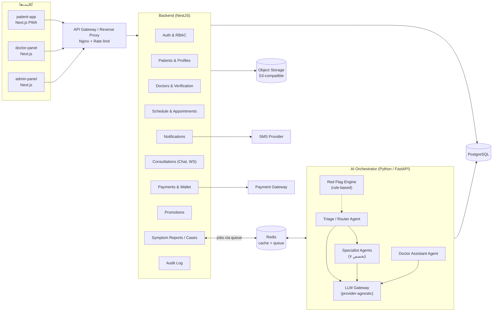
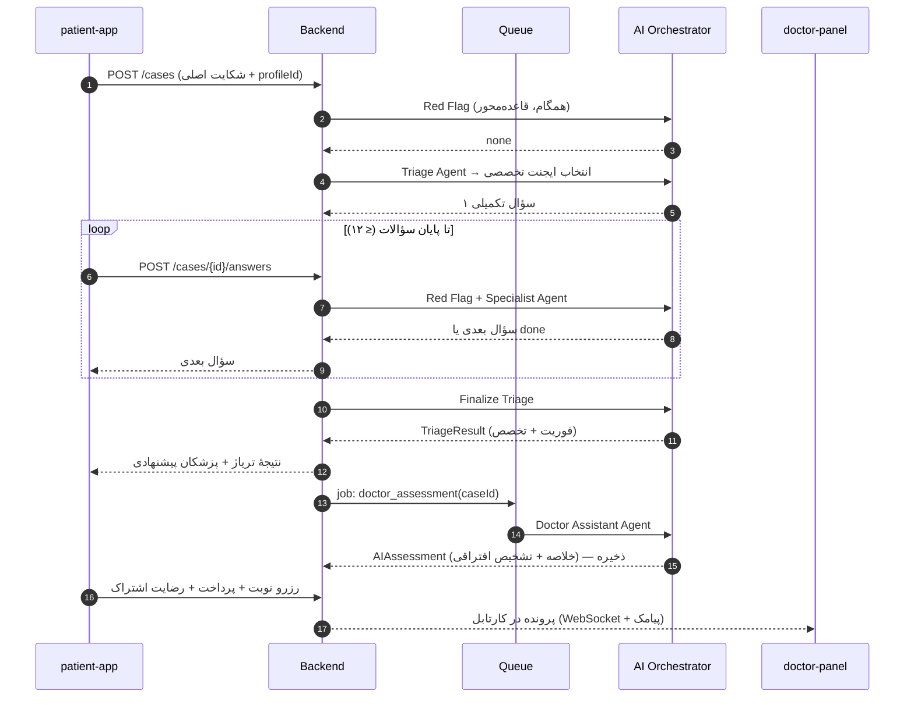
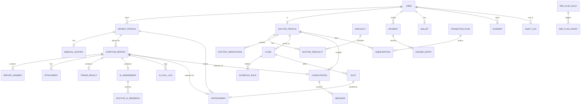
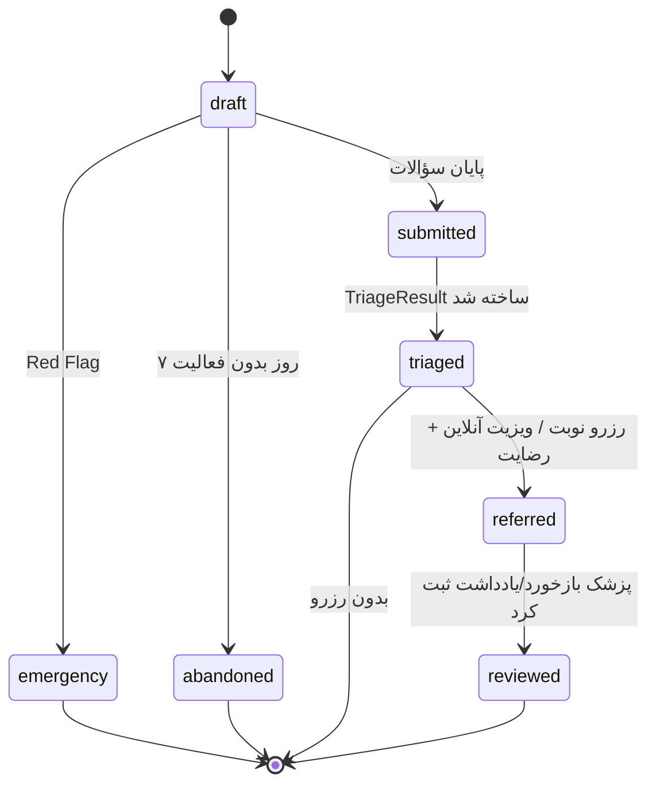
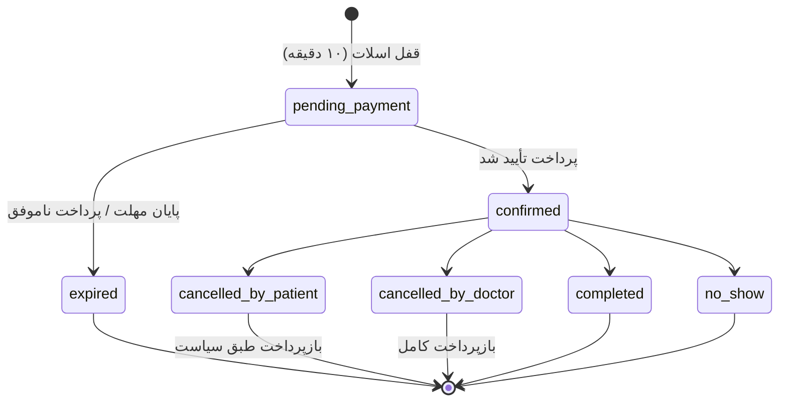
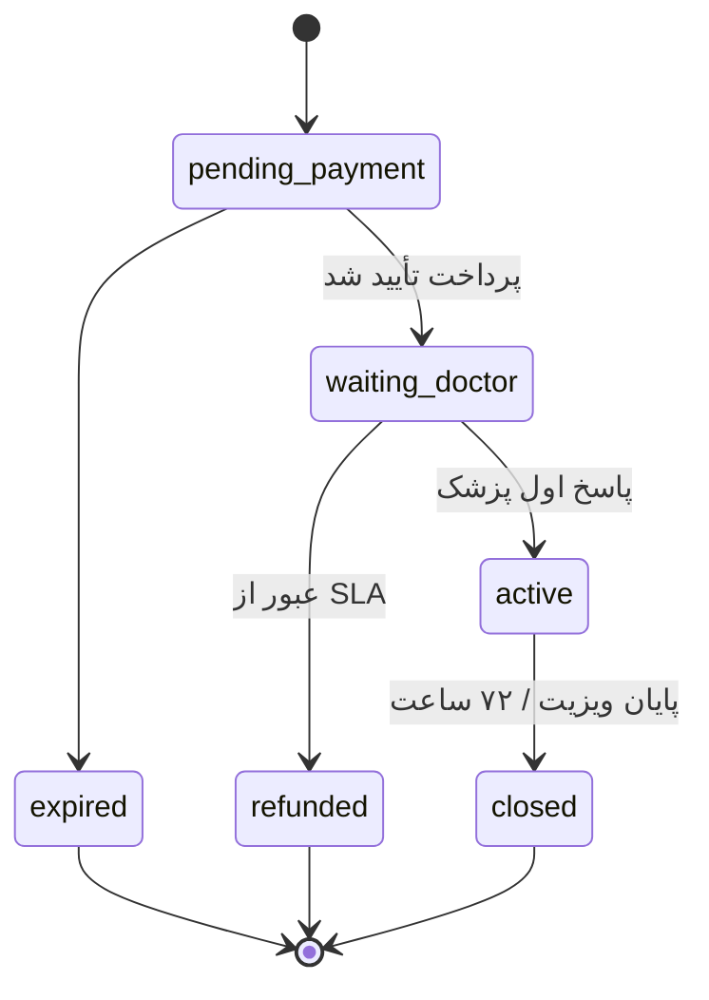
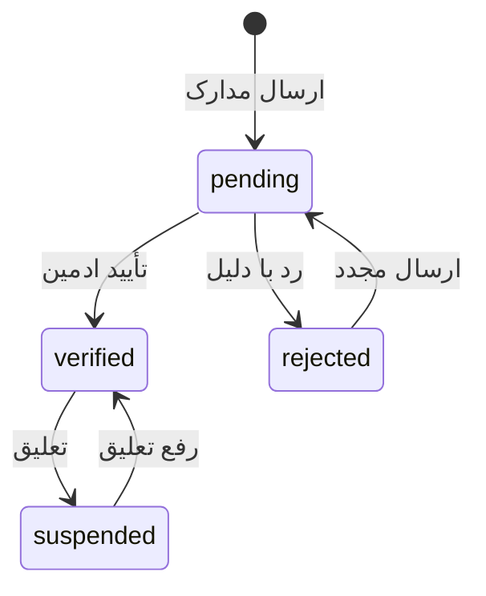
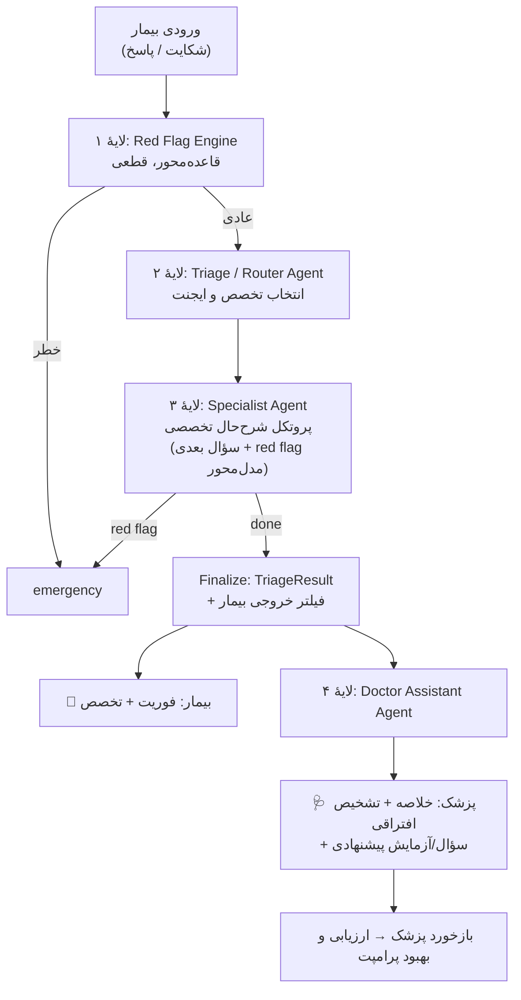

# مشخصات نیازمندی‌های نرم‌افزار (SRS) — [نام محصول]

| مورد | مقدار |
|---|---|
| نسخه | 0.1 (پیش‌نویس MVP) |
| تاریخ | مهر ۱۴۰۵ |
| سند مرتبط | [PRD.md](./PRD.md) — اهداف، پرسوناها، داستان‌های کاربری (US-xx) |
| ساختار | الهام‌گرفته از IEEE 830 |

---

## ۱. مقدمه

### ۱.۱ هدف
این سند رفتار، معماری، داده‌ها و قیود نرم‌افزاری MVP پلتفرم [نام محصول] را مشخص می‌کند تا تیم طراحی، توسعه، AI و QA بر اساس آن کار کنند.

### ۱.۲ دامنه
سیستم شامل این اجزاست:
- **اپ بیمار** (`patient-app`) — وب ریسپانسیو / PWA
- **پنل پزشک** (`doctor-panel`) — وب، بهینه برای دسکتاپ و تبلت، قابل استفاده در موبایل
- **پنل ادمین** (`admin-panel`)
- **API Backend** — منطق کسب‌وکار، داده، پرداخت، اعلان
- **AI Orchestrator** — موتور Red Flag، ایجنت تریاژ، ایجنت‌های تخصصی، ایجنت دستیار پزشک

### ۱.۳ تعاریف

| اصطلاح | تعریف |
|---|---|
| تریاژ (Triage) | تعیین سطح فوریت و تخصص مناسب؛ تنها خروجی AI که بیمار می‌بیند |
| تشخیص افتراقی (Differential Diagnosis) | فهرست تشخیص‌های محتمل با سطح احتمال؛ فقط پزشک می‌بیند |
| Red Flag | علامت یا ترکیب علائمی که نیاز به اقدام فوری اورژانسی دارد |
| گزارش علائم (Symptom Report) | یک «پرونده»: شکایت اصلی + پاسخ‌ها + پیوست‌ها + خروجی‌های AI |
| کارتابل (Inbox) | فهرست پرونده‌های ارجاع‌شده به پزشک در پنل پزشک |
| ایجنت تخصصی (Specialist Agent) | ماژول AI با پروتکل شرح‌حال، چک‌لیست خطر و دانش تشخیصی یک تخصص مشخص |
| ارجاع (Referral) | اتصال یک گزارش علائم به یک پزشک، از طریق رزرو نوبت یا ویزیت آنلاین |
| اسلات (Slot) | یک بازهٔ زمانی قابل رزرو در تقویم پزشک |

### ۱.۴ اولویت‌ها
P0 = موج اول لانچ، P1 = موج دوم MVP، P2 = بعد از MVP (تعریف کامل در PRD §۶).

---

## ۲. توصیف کلی

### ۲.۱ کلاس‌های کاربر و نقش‌ها (RBAC)

| نقش | دسترسی |
|---|---|
| `patient` | پروفایل‌های خود و خانواده، گزارش‌های علائم خود، نوبت‌ها، پرداخت‌ها، گفت‌وگوهای خود. **بدون دسترسی به `AIAssessment`.** |
| `doctor` (pending) | فقط تکمیل پروفایل و مدارک |
| `doctor` (verified) | پروفایل خود، تقویم، پرونده‌هایی که به **خود او** ارجاع شده، پلن‌ها، گزارش مالی خود |
| `admin` | تأیید پزشک، تنظیمات، گزارش‌ها؛ دسترسی به داده‌های بالینی فقط با دلیل ثبت‌شده (break-glass) |
| `support` (اختیاری) | مشاهدهٔ نوبت/پرداخت بدون دسترسی به محتوای بالینی |

### ۲.۲ محیط عملیاتی
- مرورگرهای مدرن موبایل (Chrome اندروید، Safari iOS) و دسکتاپ؛ دو نسخهٔ آخر.
- رابط کاملاً فارسی و راست‌چین، تقویم شمسی، اعداد فارسی در نمایش.
- میزبانی روی زیرساخت ابری داخل ایران (پیشنهاد: ابر داخلی دارای Kubernetes یا VM + Object Storage سازگار با S3).

### ۲.۳ محدودیت‌ها و فرضیات
- پرداخت فقط از طریق درگاه‌های داخلی شاپرکی.
- OTP و اعلان از طریق سرویس پیامک داخلی.
- دسترسی به APIهای LLM خارجی تضمین‌شده نیست → معماری باید مدل را قابل تعویض نگه دارد (§۸.۵).
- احراز هویت پزشک در MVP دستی است (بدون API رسمی نظام پزشکی).

---

## ۳. معماری سیستم

### ۳.۱ نمای کلی



### ۳.۲ تصمیم‌های فنی پیشنهادی

| لایه | پیشنهاد | دلیل |
|---|---|---|
| فرانت‌اند | **Next.js (React) + TypeScript** در یک monorepo (Turborepo) با سه اپ و یک پکیج UI مشترک | سه اپ جدا (خواستهٔ محصول) ولی کامپوننت و طراحی مشترک؛ SSR برای سئوی صفحات پزشکان |
| بک‌اند | **NestJS (TypeScript)** — ماژولار مونولیت | زبان مشترک با فرانت برای تیم کوچک؛ ماژول‌بندی تمیز؛ بعداً قابل شکستن به سرویس |
| سرویس AI | **Python + FastAPI** جدا | اکوسیستم LLM و ارزیابی در پایتون غنی‌تر است؛ ایزوله‌سازی داده و مقیاس جدا |
| پایگاه داده | **PostgreSQL 16** (+ pgvector برای بازیابی دانش در آینده) | تراکنش‌های مالی، JSONB برای خروجی AI |
| صف و کش | **Redis** + BullMQ | پردازش ناهمگام AI، قفل اسلات، محدودیت نرخ OTP |
| بلادرنگ | WebSocket (Socket.IO) | چت ویزیت آنلاین، اعلان کارتابل |
| فایل | Object Storage سازگار با S3، لینک‌های امضاشده و کوتاه‌مدت | پیوست‌های پزشکی |
| استقرار | Docker + Kubernetes (یا Docker Compose در بتا)، CI/CD با GitHub Actions | |
| پایش | Sentry (خطا)، Prometheus + Grafana (متریک)، لاگ ساختاریافته | |

> ❓ **تصمیم باز:** اگر تیم مسلط به Python/Django است، بک‌اند اصلی هم می‌تواند Django باشد؛ قراردادهای این سند مستقل از فریم‌ورک‌اند.

### ۳.۳ جریان پردازش یک گزارش علائم



نکته: `AIAssessment` بلافاصله بعد از تریاژ و ناهمگام ساخته می‌شود تا هنگام رزرو آماده باشد؛ ولی **فقط بعد از ارجاع و رضایت بیمار** برای پزشک قابل مشاهده است.

---

## ۴. نیازمندی‌های عملکردی

قالب: شناسه — شرح — اولویت. معیار پذیرش تفصیلی هر داستان در PRD §۸ آمده است.

### ۴.۱ احراز هویت (AUTH)

| ID | نیازمندی | اولویت |
|---|---|---|
| FR-AUTH-01 | ورود/ثبت‌نام با شمارهٔ موبایل و OTP پنج‌رقمی، اعتبار ۱۲۰ ثانیه، حداکثر ۵ تلاش، ارسال مجدد بعد از ۶۰ ثانیه | P0 |
| FR-AUTH-02 | محدودیت نرخ: حداکثر ۵ درخواست OTP در ساعت برای هر شماره و ۲۰ برای هر IP | P0 |
| FR-AUTH-03 | توکن دسترسی کوتاه‌مدت (۱۵ دقیقه) + Refresh Token در کوکی HttpOnly، قابل ابطال | P0 |
| FR-AUTH-04 | یک شمارهٔ موبایل می‌تواند هم حساب بیمار و هم پزشک داشته باشد؛ نقش‌ها جدا و هر پنل فقط نقش خود را می‌پذیرد | P0 |
| FR-AUTH-05 | ورود به پنل ادمین با OTP + رمز عبور (دو عاملی) و محدودیت IP | P0 |

### ۴.۲ بیمار و پروفایل (PAT)

| ID | نیازمندی | اولویت |
|---|---|---|
| FR-PAT-01 | ایجاد/ویرایش پروفایل اصلی: نام، تاریخ تولد، جنس (اجباری)؛ قد، وزن، شهر (اختیاری) | P0 |
| FR-PAT-02 | سوابق پزشکی: بیماری‌های زمینه‌ای (انتخاب از لیست + متن آزاد)، داروها، حساسیت‌ها، جراحی‌ها، بارداری، سیگار/الکل | P0 |
| FR-PAT-03 | پروفایل‌های وابسته (فرزند، والدین، همسر) تحت یک حساب؛ حداکثر ۶ پروفایل | P0 |
| FR-PAT-04 | ثبت رضایت‌نامهٔ آگاهانه (نسخه‌دار) قبل از اولین استفاده از AI و قبل از اشتراک پرونده با پزشک | P0 |
| FR-PAT-05 | تاریخچهٔ گزارش‌ها، نوبت‌ها و ویزیت‌ها همراه با توصیه‌های منتشرشدهٔ پزشک | P0 |
| FR-PAT-06 | درخواست حذف حساب و داده‌ها (با رعایت مدت نگهداری قانونی سوابق مالی) | P0 |

### ۴.۳ هوش مصنوعی و گزارش علائم (AI)

| ID | نیازمندی | اولویت |
|---|---|---|
| FR-AI-01 | ایجاد گزارش علائم برای یکی از پروفایل‌ها با شکایت اصلی (متن آزاد ≤ ۵۰۰ کاراکتر + انتخاب چیپ علائم رایج) | P0 |
| FR-AI-02 | موتور Red Flag قاعده‌محور روی هر ورودی بیمار (شکایت، هر پاسخ) **قبل از** فراخوانی LLM اجرا شود؛ قوانین در پایگاه داده و قابل ویرایش توسط ادمین با تاریخچهٔ نسخه | P0 |
| FR-AI-03 | در صورت فعال شدن Red Flag: توقف فرایند، نمایش صفحهٔ اورژانس (دکمهٔ تماس ۱۱۵ / برای خطر خودکشی ۱۲۳ و ۱۴۸۰)، تنظیم وضعیت پرونده به `emergency`، ثبت رویداد | P0 |
| FR-AI-04 | ایجنت تریاژ بر اساس شکایت اصلی و پروفایل یکی از ایجنت‌های تخصصی را انتخاب کند؛ در صورت ابهام، ایجنت «داخلی/عمومی» | P0 |
| FR-AI-05 | ایجنت تخصصی سؤالات تکمیلی را یکی‌یکی تولید کند؛ هر سؤال با نوع (`single`, `multi`, `scale`, `text`, `duration`) و گزینه‌ها؛ حداکثر ۱۲ سؤال؛ امکان «نمی‌دانم» | P0 |
| FR-AI-06 | ایجنت تخصصی هم می‌تواند Red Flag مدل‌محور گزارش دهد؛ ترکیب با قاعده‌محور با قانون «سخت‌گیرانه‌ترین برنده» | P0 |
| FR-AI-07 | خروجی نهایی تریاژ برای بیمار: `urgency` ∈ {`emergency`, `within_24h`, `within_days`, `routine`}، تخصص اصلی، تخصص جایگزین، توضیح غیرتشخیصی ≤ ۳ جمله | P0 |
| FR-AI-08 | **فیلتر خروجی سمت بیمار:** متن توضیح از یک فیلتر عبور کند که نام بیماری/تشخیص را حذف یا بازنویسی کند؛ در صورت شکست فیلتر، متن پیش‌فرض نمایش داده شود | P0 |
| FR-AI-09 | ایجنت دستیار پزشک برای هر گزارش تریاژشده `AIAssessment` بسازد: خلاصهٔ بالینی ساختاریافته، ۳ تا ۵ تشخیص افتراقی با احتمال (`high`/`medium`/`low`) و دلیل، سؤالات پیشنهادی، معاینه/آزمایش پیشنهادی، علائم هشدار برای پایش | P0 |
| FR-AI-10 | `AIAssessment` هرگز از طریق APIهای نقش `patient` قابل دریافت نباشد (کنترل در سطح API و تست خودکار) | P0 |
| FR-AI-11 | ذخیرهٔ کامل ورودی/خروجی هر فراخوانی AI همراه با `agent`, `prompt_version`, `model_id`, زمان و هزینه (توکن) | P0 |
| FR-AI-12 | حذف شناسه‌های هویتی (نام، موبایل، کد ملی، آدرس) قبل از ارسال به LLM؛ فقط سن، جنس، سوابق و علائم ارسال شود | P0 |
| FR-AI-13 | Fallback: اگر AI ظرف ۲۰ ثانیه پاسخ ندهد یا خطا دهد، فرم ثابت عمومی سؤالات جایگزین شود و پرونده با تخصص «داخلی/عمومی» و برچسب `ai_unavailable` ادامه یابد | P0 |
| FR-AI-14 | پیش‌نویس گزارش ذخیره شود و تا ۷ روز قابل ادامه باشد | P0 |
| FR-AI-15 | پیوست فایل (JPG/PNG/PDF، حداکثر ۵ فایل × ۱۰MB)؛ فایل‌ها به AI داده **نمی‌شوند** و فقط پزشک ارجاع‌شده می‌بیند | P0 |
| FR-AI-16 | پرسش آزاد پزشک از دستیار AI در صفحهٔ پرونده (پاسخ فقط برای پزشک، ذخیره در تاریخچهٔ پرونده) | P1 |

### ۴.۴ کشف و پیشنهاد پزشک (SRC)

| ID | نیازمندی | اولویت |
|---|---|---|
| FR-SRC-01 | بعد از تریاژ، لیست پزشکان تأییدشده با تخصص منطبق، مرتب بر اساس: شهر بیمار، نزدیک‌ترین نوبت خالی، تطابق زمینهٔ کاری با علائم | P0 |
| FR-SRC-02 | جست‌وجوی دستی: نام، تخصص، شهر، نوع ویزیت، جنسیت پزشک، «نوبت خالی امروز/این هفته» | P0 |
| FR-SRC-03 | صفحهٔ عمومی پروفایل پزشک با URL ثابت و قابل ایندکس (SSR + داده‌های ساختاریافتهٔ Schema.org `Physician`) | P0 |
| FR-SRC-04 | جایگاه «پیشنهاد ویژه» (حداکثر ۲ مورد) بالای لیست، با برچسب «تبلیغ»، فقط از پزشکان دارای پلن فعال **و** تخصص منطبق؛ ترتیب چرخشی منصفانه | P1 |
| FR-SRC-05 | الگوریتم رتبه‌بندی ارگانیک (FR-SRC-01) و خروجی تریاژ هیچ ورودی از وضعیت پروموت نگیرند (تست خودکار) | P0 |

### ۴.۵ پزشک (DOC)

| ID | نیازمندی | اولویت |
|---|---|---|
| FR-DOC-01 | ثبت‌نام پزشک: نام، کد ملی، شمارهٔ نظام پزشکی (یکتا)، تخصص/فوق‌تخصص، آپلود کارت نظام و پروانه | P0 |
| FR-DOC-02 | وضعیت احراز: `pending` → `verified` / `rejected` (با دلیل) / `suspended`؛ پروفایل عمومی فقط در `verified` | P0 |
| FR-DOC-03 | ویرایش پروفایل عمومی: عکس، بیو (≤ ۱۰۰۰ کاراکتر)، زمینه‌های کاری (برچسب)، زبان‌ها، تعرفهٔ حضوری و آنلاین؛ تغییر تخصص نیاز به تأیید مجدد ادمین دارد | P0 |
| FR-DOC-04 | تعریف یک یا چند مطب (نام، آدرس، مختصات نقشه، تلفن) | P0 |
| FR-DOC-05 | کارتابل: لیست نوبت‌ها و پرونده‌ها با فیلتر (امروز، آینده، آنلاین، بررسی‌نشده) و برچسب فوریت | P0 |
| FR-DOC-06 | صفحهٔ پرونده: پروفایل و سوابق بیمار، خلاصهٔ بالینی AI، تشخیص‌های افتراقی AI (عنوان: «تشخیص AI بر اساس علائم دریافتی»)، سؤالات و آزمایش‌های پیشنهادی، پاسخ‌های خام، پیوست‌ها؛ برچسب «پیشنهاد AI — تصمیم نهایی با پزشک» | P0 |
| FR-DOC-07 | بازخورد روی AI: برای هر تشخیص `agree`/`edit`/`disagree`، تشخیص نهایی (متن یا ICD-10)، صحت تخصص پیشنهادی، امتیاز ۱–۵ | P0 |
| FR-DOC-08 | یادداشت ویزیت خصوصی (فقط پزشک) و توصیهٔ منتشرشده برای بیمار | P0 |
| FR-DOC-09 | گزارش مالی: ویزیت‌ها، مبالغ، کمیسیون، موجودی و درخواست تسویه | P1 |

### ۴.۶ تقویم و نوبت (APT)

| ID | نیازمندی | اولویت |
|---|---|---|
| FR-APT-01 | برنامهٔ هفتگی برای هر مطب: روزها، بازهٔ ساعت، طول نوبت (۱۰ تا ۶۰ دقیقه)؛ تولید خودکار اسلات برای ۳۰ روز آینده | P0 |
| FR-APT-02 | بستن روز/بازهٔ خاص (مرخصی)؛ نوبت‌های رزروشدهٔ آن بازه به پزشک هشدار داده شود و لغو با بازپرداخت کامل انجام شود | P0 |
| FR-APT-03 | رزرو: قفل اسلات ۱۰ دقیقه (Redis) تا پرداخت؛ جلوگیری از رزرو هم‌زمان (قید یکتا در DB روی اسلات) | P0 |
| FR-APT-04 | پیامک تأیید رزرو و یادآوری ۲۴ ساعت و ۲ ساعت قبل | P0 |
| FR-APT-05 | لغو توسط بیمار با سیاست بازپرداخت قابل تنظیم (ادمین: پیش‌فرض؛ پزشک: در محدودهٔ مجاز) | P0 |
| FR-APT-06 | پزشک/منشی وضعیت نوبت را `completed` یا `no_show` ثبت کند؛ نوبت‌های تأییدنشده ۲۴ ساعت بعد خودکار `completed` | P0 |
| FR-APT-07 | اتصال گزارش علائم به نوبت هنگام رزرو (اختیاری با رضایت)؛ رزرو بدون گزارش علائم هم مجاز است | P0 |
| FR-APT-08 | ظرفیت روزانهٔ ویزیت آنلاین برای پزشک | P1 |

### ۴.۷ ویزیت آنلاین (CON)

| ID | نیازمندی | اولویت |
|---|---|---|
| FR-CON-01 | ایجاد ویزیت آنلاین متنی پس از پرداخت؛ وضعیت‌ها مطابق §۶.۳ | P1 |
| FR-CON-02 | پیام‌رسانی بلادرنگ (WebSocket) با پشتیبانی متن، تصویر، PDF؛ وضعیت «خوانده شد» | P1 |
| FR-CON-03 | اگر پزشک ظرف SLA (پیش‌فرض ۲ ساعت، قابل تنظیم) پاسخ اول ندهد → لغو و بازپرداخت خودکار + اطلاع به بیمار | P1 |
| FR-CON-04 | بسته شدن خودکار ۷۲ ساعت بعد از پاسخ اول یا با «پایان ویزیت» توسط پزشک؛ پس از بسته شدن فقط‌خواندنی | P1 |
| FR-CON-05 | قالب‌های پاسخ آماده برای پزشک | P1 |
| FR-CON-06 | تماس صوتی/تصویری | P2 |

### ۴.۸ پرداخت (PAY)

| ID | نیازمندی | اولویت |
|---|---|---|
| FR-PAY-01 | اتصال به درگاه پرداخت شاپرکی از طریق یک لایهٔ Adapter (امکان تعویض درگاه) | P0 |
| FR-PAY-02 | انواع پرداخت: پیش‌پرداخت/کارمزد نوبت حضوری، هزینهٔ ویزیت آنلاین، خرید پلن پروموت | P0 |
| FR-PAY-03 | تأیید (Verify) سمت سرور پس از بازگشت از درگاه؛ عملیات idempotent با کلید یکتا؛ تطبیق دوره‌ای تراکنش‌های معلق | P0 |
| FR-PAY-04 | کیف پول بیمار برای بازپرداخت‌ها و استفاده در پرداخت بعدی؛ امکان درخواست برداشت به کارت | P0 |
| FR-PAY-05 | دفتر کل (Ledger) دوطرفه برای هر تراکنش: سهم پزشک، کمیسیون پلتفرم | P0 |
| FR-PAY-06 | تسویه با پزشک: دستی توسط ادمین در MVP یا تسهیم خودکار درگاه در صورت پشتیبانی | P1 |
| FR-PAY-07 | صدور رسید قابل دانلود برای هر پرداخت | P0 |

### ۴.۹ پروموت (PRM)

| ID | نیازمندی | اولویت |
|---|---|---|
| FR-PRM-01 | تعریف پلن‌ها توسط ادمین: نام، قیمت، مدت (روز)، مزایا (`featured_slot`, `badge`, `search_boost`, `analytics`) | P1 |
| FR-PRM-02 | خرید پلن توسط پزشک تأییدشده با پرداخت آنلاین؛ تمدید دستی؛ یادآوری ۳ روز قبل از انقضا | P1 |
| FR-PRM-03 | نمایش برچسب «تبلیغ» روی هر جایگاه پولی و نشان «پزشک ویژه» در پروفایل | P1 |
| FR-PRM-04 | داشبورد آمار: نمایش در نتایج، بازدید پروفایل، کلیک نوبت، رزرو (روزانه) | P1 |
| FR-PRM-05 | `search_boost` فقط در جست‌وجوی دستی اعمال شود، نه در لیست پیشنهادی پس از تریاژ (FR-SRC-05) | P1 |
| FR-PRM-06 | امکان پلن رایگان آزمایشی که ادمین به پزشک اعطا کند (جذب اولیه) | P1 |

### ۴.۱۰ اعلان (NTF)

| ID | نیازمندی | اولویت |
|---|---|---|
| FR-NTF-01 | پیامک: OTP، تأیید و یادآوری نوبت، لغو، پرونده جدید برای پزشک، نتیجهٔ احراز پزشک | P0 |
| FR-NTF-02 | اعلان درون‌برنامه‌ای (In-app) و Web Push برای پیام جدید ویزیت آنلاین | P1 |
| FR-NTF-03 | قالب‌های پیامک قابل ویرایش توسط ادمین؛ **هیچ اطلاعات بالینی در متن پیامک نیاید** | P0 |

### ۴.۱۱ ادمین (ADM)

| ID | نیازمندی | اولویت |
|---|---|---|
| FR-ADM-01 | صف احراز پزشک: مشاهدهٔ مدارک، لینک استعلام نظام پزشکی، تأیید/رد با دلیل، تعلیق | P0 |
| FR-ADM-02 | مدیریت تخصص‌ها، زیرتخصص‌ها، شهرها، و نگاشت تخصص ↔ ایجنت | P0 |
| FR-ADM-03 | مدیریت قوانین Red Flag (ایجاد، ویرایش، غیرفعال‌سازی، تاریخچه، اجرای آزمایشی روی متن نمونه) | P0 |
| FR-ADM-04 | گزارش تراکنش‌ها، بازپرداخت‌ها، نوبت‌ها؛ خروجی CSV | P0 |
| FR-ADM-05 | تنظیم کمیسیون، کارمزد، سیاست لغو پیش‌فرض، SLA ویزیت آنلاین | P0 |
| FR-ADM-06 | داشبورد کیفیت AI: نرخ موافقت تخصص، دقت Top-3، امتیاز خلاصه، به تفکیک ایجنت و نسخهٔ پرامپت؛ لیست رویدادهای اورژانس | P1 |
| FR-ADM-07 | دسترسی break-glass به محتوای بالینی با ثبت دلیل در Audit Log | P0 |

---

## ۵. مدل داده

### ۵.۱ نمودار موجودیت‌ها (ERD)



### ۵.۲ فیلدهای کلیدی

| موجودیت | فیلدهای مهم |
|---|---|
| `user` | id, mobile (یکتا), roles[], status, created_at |
| `patient_profile` | id, user_id, relation (`self`/`child`/`parent`/`spouse`/`other`), first_name, last_name, birth_date, sex, city_id |
| `medical_history` | profile_id, conditions JSONB, medications JSONB, allergies JSONB, surgeries JSONB, pregnancy, smoking, alcohol, updated_at |
| `symptom_report` | id, profile_id, chief_complaint, status, specialist_agent, urgency, red_flag (bool), ai_unavailable (bool), created_at, submitted_at |
| `report_answer` | report_id, seq, question JSONB (متن، نوع، گزینه‌ها), answer JSONB, agent, created_at |
| `triage_result` | report_id, urgency, primary_specialty_id, alt_specialty_id, patient_explanation, prompt_version, model_id |
| `ai_assessment` | report_id, clinical_summary JSONB, differentials JSONB, suggested_questions JSONB, suggested_workup JSONB, watch_for JSONB, prompt_version, model_id, created_at |
| `doctor_ai_feedback` | assessment_id, doctor_id, per_diagnosis JSONB, final_diagnosis_text, final_icd10, specialty_correct, correct_specialty_id, usefulness (1–5) |
| `ai_call_log` | id, report_id, agent, prompt_version, model_id, input_redacted JSONB, output JSONB, latency_ms, tokens_in, tokens_out, error |
| `doctor_profile` | id, user_id, national_id (رمزنگاری‌شده), irimc_number (یکتا), verification_status, bio, focus_tags[], fee_in_person, fee_online, languages[], slug |
| `slot` | id, clinic_id, start_at, end_at, status (`open`/`held`/`booked`/`blocked`), UNIQUE(clinic_id, start_at) |
| `appointment` | id, slot_id (UNIQUE), patient_profile_id, doctor_id, report_id NULL, status, share_report_consent, payment_id |
| `consultation` | id, report_id NULL, patient_profile_id, doctor_id, status, first_response_due_at, closed_at, payment_id |
| `payment` | id, user_id, purpose, amount, gateway, authority, ref_id, status, idempotency_key (یکتا) |
| `ledger_entry` | id, payment_id, account (`doctor:{id}`/`platform`/`wallet:{id}`), debit, credit |
| `promotion_plan` / `subscription` | plan: name, price, duration_days, benefits JSONB / sub: doctor_id, plan_id, starts_at, ends_at, status |
| `red_flag_rule` | id, name, pattern (عبارات/کلیدواژه‌ها + شرط سن/جنس), action (`emergency`/`suicide_risk`), version, active |
| `consent` | user_id, profile_id, type (`ai_processing`/`share_with_doctor`/`terms`), version, granted_at, revoked_at |
| `audit_log` | actor_id, role, action, entity, entity_id, reason, ip, at |

مبالغ به **ریال** و به صورت عدد صحیح (`BIGINT`) ذخیره می‌شوند؛ زمان‌ها UTC و نمایش با تقویم شمسی و منطقهٔ زمانی تهران.

---

## ۶. ماشین حالت‌ها

### ۶.۱ گزارش علائم



### ۶.۲ نوبت حضوری



### ۶.۳ ویزیت آنلاین (P1)



### ۶.۴ احراز پزشک



---

## ۷. API اصلی (REST، نسخهٔ `/api/v1`)

فهرست زیر endpointهای کلیدی است، نه همهٔ آن‌ها. مستندات کامل با OpenAPI از کد تولید می‌شود.

| متد و مسیر | نقش | شرح |
|---|---|---|
| `POST /auth/otp/request` | عمومی | درخواست OTP |
| `POST /auth/otp/verify` | عمومی | تأیید OTP و صدور توکن |
| `GET/POST/PATCH /me/profiles` | patient | پروفایل‌های بیمار و خانواده |
| `PUT /me/profiles/{id}/history` | patient | سوابق پزشکی |
| `POST /consents` | patient | ثبت رضایت |
| `POST /cases` | patient | ایجاد گزارش علائم ← اولین سؤال یا وضعیت اورژانس |
| `POST /cases/{id}/answers` | patient | ارسال پاسخ ← سؤال بعدی / نتیجهٔ تریاژ |
| `GET /cases/{id}` | patient | وضعیت و **TriageResult** (بدون AIAssessment) |
| `POST /cases/{id}/attachments` | patient | لینک آپلود امضاشده |
| `GET /doctors?specialty=&city=&type=&available=` | عمومی | جست‌وجو |
| `GET /cases/{id}/recommended-doctors` | patient | پزشکان پیشنهادی + جایگاه ویژه (P1) |
| `GET /doctors/{slug}` | عمومی | پروفایل عمومی |
| `GET /doctors/{id}/slots?from=&to=` | عمومی | اسلات‌های خالی |
| `POST /appointments` | patient | قفل اسلات + ایجاد پرداخت |
| `POST /appointments/{id}/cancel` | patient/doctor | لغو |
| `POST /payments/{id}/callback` | درگاه | بازگشت از درگاه و Verify |
| `POST /consultations` · `GET /consultations/{id}/messages` · `WS /ws` | patient/doctor | ویزیت آنلاین (P1) |
| `POST /doctor/onboarding` | doctor | ثبت مدارک |
| `GET/PUT /doctor/clinics` · `/doctor/schedule-rules` | doctor | مطب‌ها و تقویم |
| `GET /doctor/inbox?filter=` | doctor | کارتابل |
| `GET /doctor/cases/{id}` | doctor | پرونده **شامل AIAssessment** — فقط اگر ارجاع به همین پزشک باشد |
| `POST /doctor/cases/{id}/feedback` | doctor | بازخورد روی AI |
| `POST /doctor/cases/{id}/notes` | doctor | یادداشت خصوصی / توصیهٔ منتشرشده |
| `POST /doctor/cases/{id}/ask-ai` | doctor | پرسش از دستیار (P1) |
| `GET/POST /doctor/subscriptions` | doctor | پلن‌های پروموت (P1) |
| `/admin/*` | admin | احراز، تنظیمات، قوانین Red Flag، گزارش‌ها |

**قانون امنیتی مهم:** سریالایزر/DTO پاسخ‌های نقش `patient` هیچ فیلدی از `ai_assessment` ندارد؛ این با تست قرارداد (Contract Test) روی همهٔ endpointهای بیمار تضمین می‌شود.

---

## ۸. قرارداد ایجنت‌های AI

### ۸.۱ چیدمان لایه‌ها



**ایجنت‌های تخصصی MVP:** داخلی/عمومی (پیش‌فرض)، قلب و عروق، پوست، کودکان، زنان و زایمان، گوش‌وحلق‌وبینی، مغز و اعصاب.

هر ایجنت تخصصی یک **بستهٔ پروتکل** نسخه‌دار دارد که با پزشک مشاور همان رشته نوشته می‌شود:
- چک‌لیست شرح‌حال (OPQRST/SOCRATES و موارد اختصاصی تخصص)
- علائم خطر اختصاصی تخصص
- فهرست تشخیص‌های شایع و «نباید از دست برود» (Can't-miss)
- سؤالات و آزمایش‌های پیشنهادی رایج
- پرامپت سیستم + نمونه‌ها (Few-shot)

> نکته دربارهٔ پیشنهاد «ایجنت تخصصی به جای درگیر کردن AI عمومی»: ایجنت‌های تخصصی هم زیر سطح از یک مدل زبانی استفاده می‌کنند، اما با پروتکل، خروجی ساختاریافته و دامنهٔ محدود. یعنی AI عمومی «آزاد» هیچ‌جا مستقیم با بیمار حرف نمی‌زند. در آینده می‌توان برای هر تخصص مدل اختصاصی Fine-tune کرد بدون تغییر قرارداد.

### ۸.۲ قرارداد Triage/Router Agent

ورودی:
```json
{
  "patient": { "age_years": 34, "sex": "female", "pregnant": false,
               "conditions": ["hypothyroidism"], "medications": ["levothyroxine"], "allergies": [] },
  "chief_complaint": "چند روزه سرگیجه دارم و قلبم تند می‌زنه",
  "chips": ["dizziness", "palpitations"]
}
```
خروجی:
```json
{
  "specialist_agent": "cardiology",
  "confidence": "medium",
  "alternatives": ["ent", "internal"],
  "red_flag": null
}
```

### ۸.۳ قرارداد Specialist Agent (هر گام)

خروجی:
```json
{
  "status": "ask",
  "question": {
    "id": "q3",
    "text": "تپش قلب معمولاً چقدر طول می‌کشد؟",
    "type": "single",
    "options": ["چند ثانیه", "چند دقیقه", "بیش از نیم ساعت", "نمی‌دانم"]
  },
  "red_flag": null
}
```
گام پایانی:
```json
{
  "status": "done",
  "triage": {
    "urgency": "within_days",
    "primary_specialty": "cardiology",
    "alt_specialty": "internal",
    "patient_explanation": "علائم شما بیشتر به حوزهٔ قلب و عروق مربوط است. پیشنهاد می‌شود طی چند روز آینده ویزیت شوید."
  },
  "red_flag": null
}
```
اگر `red_flag` غیرخالی باشد: `{ "type": "emergency" | "suicide_risk", "reason": "..." }` و فرایند متوقف می‌شود.

### ۸.۴ قرارداد Doctor Assistant Agent

```json
{
  "clinical_summary": {
    "chief_complaint": "سرگیجه و تپش قلب از ۴ روز پیش",
    "hpi": "زن ۳۴ ساله با سابقهٔ هیپوتیروئیدی تحت درمان با لووتیروکسین…",
    "pertinent_positives": ["تپش قلب چنددقیقه‌ای", "سرگیجه هنگام ایستادن"],
    "pertinent_negatives": ["درد قفسهٔ سینه", "سنکوپ", "تنگی نفس"]
  },
  "differentials": [
    { "name": "Overreplacement of levothyroxine / iatrogenic hyperthyroidism", "likelihood": "high",
      "reasoning": "مصرف لووتیروکسین + تپش قلب + …" },
    { "name": "Paroxysmal SVT", "likelihood": "medium", "reasoning": "…" },
    { "name": "Orthostatic hypotension", "likelihood": "medium", "reasoning": "…" }
  ],
  "cant_miss": ["Arrhythmia with structural heart disease"],
  "suggested_questions": ["آخرین TSH کی بوده؟", "آیا دوز دارو اخیراً تغییر کرده؟"],
  "suggested_workup": ["ECG", "TSH, Free T4", "CBC", "اندازه‌گیری فشار خوابیده/ایستاده"],
  "watch_for": ["سنکوپ", "درد قفسهٔ سینه"],
  "disclaimer": "پیشنهاد هوش مصنوعی — تصمیم نهایی با پزشک است."
}
```

### ۸.۵ قواعد پیاده‌سازی AI
1. **خروجی ساختاریافته اجباری:** همهٔ خروجی‌ها با JSON Schema اعتبارسنجی می‌شوند؛ خروجی نامعتبر یک بار تکرار و سپس Fallback (FR-AI-13).
2. **LLM Gateway مستقل از ارائه‌دهنده:** یک اینترفیس واحد (`complete(messages, schema, model)`) با Adapter برای هر ارائه‌دهنده یا مدل self-hosted؛ انتخاب مدل برای هر ایجنت از طریق پیکربندی.
3. **پرامپت‌ها نسخه‌دار** در مخزن کد (`prompts/{agent}/{version}.md`)؛ هر تغییر باید مجموعهٔ آزمون بالینی (§۱۰) را پاس کند.
4. **حذف شناسه‌ها** قبل از ارسال (FR-AI-12) و عدم ارسال فایل‌های پیوست به مدل.
5. **دما (temperature) پایین** و محدودیت طول خروجی.
6. **فیلتر خروجی بیمار** (FR-AI-08): لیست سیاه اصطلاحات تشخیصی + بررسی دوم با مدل؛ در صورت شک، متن پیش‌فرض.
7. **محدودیت هزینه:** سقف توکن برای هر پرونده و هشدار هزینه در داشبورد.

> ❓ **تصمیم باز:** انتخاب مدل/ارائه‌دهنده پس از بنچمارک روی ۱۰۰ سناریوی فارسی (§۱۰) و بررسی حقوقی محل پردازش داده.

---

## ۹. نیازمندی‌های غیرعملکردی

### ۹.۱ امنیت و حریم خصوصی

| ID | نیازمندی |
|---|---|
| NFR-SEC-01 | TLS 1.2+ برای همهٔ ارتباطات؛ HSTS |
| NFR-SEC-02 | رمزنگاری at-rest برای دیسک DB و Object Storage؛ رمزنگاری سطح فیلد برای کد ملی و فیلدهای `medical_history` |
| NFR-SEC-03 | کنترل دسترسی سطح رکورد: پزشک فقط پرونده‌های ارجاع‌شده به خودش؛ بیمار فقط پروفایل‌های حساب خودش (تست خودکار برای IDOR) |
| NFR-SEC-04 | Audit Log تغییرناپذیر (append-only) برای هر مشاهده/تغییر دادهٔ بالینی توسط پزشک و ادمین |
| NFR-SEC-05 | لینک‌های فایل امضاشده با اعتبار ≤ ۵ دقیقه؛ اسکن نوع فایل و حذف متادیتای EXIF |
| NFR-SEC-06 | محافظت OWASP Top 10: اعتبارسنجی ورودی، CSRF، Rate limit، هدرهای امنیتی، وابستگی‌های به‌روز (Dependabot) |
| NFR-SEC-07 | عدم ثبت داده‌های بالینی و توکن‌ها در لاگ‌های عملیاتی |
| NFR-SEC-08 | پشتیبان‌گیری رمزنگاری‌شدهٔ روزانه، نگهداری ۳۰ روز، آزمون بازیابی ماهانه |
| NFR-SEC-09 | آزمون نفوذ (Penetration Test) قبل از لانچ موج اول |
| NFR-PRV-01 | رضایت آگاهانهٔ نسخه‌دار (FR-PAT-04)؛ امکان لغو اشتراک گزارش با پزشک تا قبل از مشاهده |
| NFR-PRV-02 | داده‌های بالینی در سرورهای داخل کشور نگهداری شوند (مگر خلاف آن پس از بررسی حقوقی تصمیم گرفته شود) |

### ۹.۲ کارایی و مقیاس

| ID | نیازمندی |
|---|---|
| NFR-PRF-01 | p95 زمان پاسخ APIهای غیر-AI < ۳۰۰ میلی‌ثانیه |
| NFR-PRF-02 | p95 زمان تولید سؤال بعدی توسط ایجنت تخصصی < ۶ ثانیه؛ تولید نتیجهٔ تریاژ < ۱۰ ثانیه؛ سقف مطلق ۲۰ ثانیه سپس Fallback |
| NFR-PRF-03 | `AIAssessment` حداکثر ۶۰ ثانیه پس از تریاژ آماده باشد |
| NFR-PRF-04 | ظرفیت MVP: ۵۰۰ کاربر هم‌زمان، ۵٬۰۰۰ گزارش علائم در روز، ۱٬۰۰۰ پزشک |
| NFR-PRF-05 | LCP صفحات بیمار در 4G < ۲.۵ ثانیه |

### ۹.۳ دسترس‌پذیری و پایداری
- NFR-AVL-01: دسترس‌پذیری ماهانه ≥ ۹۹.۵٪ برای API اصلی.
- NFR-AVL-02: قطع سرویس AI نباید رزرو، پرداخت یا کارتابل را مختل کند (FR-AI-13).
- NFR-AVL-03: Health check و هشدار خودکار (Grafana Alerting) برای خطای پرداخت، تأخیر AI، خطای پیامک.

### ۹.۴ قابلیت استفاده و دسترس‌پذیری
- NFR-UX-01: موبایل‌فرست برای اپ بیمار؛ کمترین عرض ۳۶۰px.
- NFR-UX-02: RTL کامل، فونت فارسی خوانا، تقویم شمسی، ورودی اعداد فارسی و انگلیسی.
- NFR-UX-03: پایبندی به WCAG 2.1 سطح AA در کنتراست، اندازهٔ هدف لمسی و ناوبری صفحه‌کلید.
- NFR-UX-04: زبان ساده در سؤالات بیمار (سطح خواندن عمومی، بدون اصطلاح تخصصی).

### ۹.۵ نگهداشت‌پذیری
- NFR-MNT-01: پوشش تست واحد ≥ ۷۰٪ برای ماژول‌های پرداخت، نوبت و دسترسی.
- NFR-MNT-02: مهاجرت‌های DB نسخه‌دار؛ محیط‌های `dev`/`staging`/`prod` جدا با دادهٔ ساختگی در staging.
- NFR-MNT-03: Feature Flag برای قابلیت‌های P1 (ویزیت آنلاین، پروموت) تا مستقل روشن شوند.

---

## ۱۰. ارزیابی کیفیت AI

1. **مجموعهٔ سناریوهای بالینی (Clinical Vignettes):** حداقل ۱۰۰ سناریوی فارسی (۱۵ برای هر تخصص لانچ) که پزشکان مشاور می‌نویسند، شامل حداقل ۲۵ سناریوی اورژانسی و پاسخ‌های «بیمار» شبیه‌سازی‌شده.
2. **اجرای خودکار:** یک بیمار شبیه‌سازی‌شده (Simulated Patient) طبق سناریو به سؤالات ایجنت پاسخ می‌دهد؛ خروجی با کلید پاسخ مقایسه می‌شود. این مجموعه در CI برای هر تغییر پرامپت/مدل اجرا می‌شود.
3. **معیار قبولی لانچ:**

| معیار | آستانه |
|---|---|
| شناسایی سناریوهای اورژانسی (Red Flag) | **۱۰۰٪** |
| تخصص صحیح (اصلی یا جایگزین) | ≥ ۹۰٪ |
| سطح فوریت صحیح یا سخت‌گیرانه‌تر | ≥ ۹۵٪ |
| کم‌برآوردی فوریت (Under-triage) | ≤ ۲٪ |
| تشخیص صحیح در Top-3 دستیار پزشک | ≥ ۷۰٪ |
| نشت تشخیص در متن سمت بیمار | ۰ مورد |
| میانگین تعداد سؤال | ≤ ۱۰ |

4. **پایش پس از لانچ:** داشبورد بازخورد پزشکان (FR-ADM-06)، بازبینی هفتگی موارد اختلاف توسط پزشک مشاور، و افزودن موارد واقعیِ ناشناس‌شده به مجموعهٔ آزمون.

---

## ۱۱. استراتژی آزمون و معیار انتشار

| نوع آزمون | دامنه |
|---|---|
| واحد | منطق نوبت، قفل اسلات، محاسبهٔ بازپرداخت، دفتر کل، موتور Red Flag |
| یکپارچگی | درگاه پرداخت (Sandbox)، پیامک، صف AI |
| قرارداد (Contract) | عدم وجود `ai_assessment` در پاسخ‌های بیمار؛ اسکیمای خروجی ایجنت‌ها |
| دسترسی | IDOR: بیمار A به پروندهٔ B، پزشک X به پروندهٔ ارجاع‌نشده |
| End-to-End (Playwright) | مسیر کامل بیمار تا رزرو؛ مسیر پزشک از ثبت‌نام تا بازخورد؛ مسیر اورژانس |
| بار | ۵۰۰ کاربر هم‌زمان، رزرو هم‌زمان یک اسلات |
| بالینی AI | §۱۰ |
| امنیت | آزمون نفوذ خارجی |
| پذیرش کاربر (UAT) | بتای بسته با ۱۰ پزشک و ۵۰ بیمار |

**معیار انتشار موج اول (P0):**
- همهٔ FRهای P0 پیاده و آزموده شده‌اند.
- معیارهای §۱۰ برآورده شده‌اند.
- هیچ باگ باز با شدت Critical/High (به‌ویژه امنیت و پرداخت) وجود ندارد.
- رضایت‌نامه‌ها و شرایط استفاده توسط مشاور حقوقی تأیید شده‌اند.
- اینماد و درگاه پرداخت فعال‌اند.

---

## ۱۲. پیوست: ماتریس ردیابی (User Story ↔ FR)

| User Story (PRD) | نیازمندی‌ها (SRS) | اولویت |
|---|---|---|
| US-01 ورود با موبایل | FR-AUTH-01..04 | P0 |
| US-02 پروفایل سلامت | FR-PAT-01..04, FR-PAT-06 | P0 |
| US-03 ثبت علائم | FR-AI-01, 04, 05, 12, 14, 15 | P0 |
| US-04 نتیجهٔ تریاژ | FR-AI-07, 08, 10, 13, FR-SRC-01, 05 | P0 |
| US-05 هشدار اورژانس | FR-AI-02, 03, 06, FR-ADM-03 | P0 |
| US-06 جست‌وجوی دستی | FR-SRC-02, 03 | P0 |
| US-07 رزرو حضوری | FR-APT-03, 04, 07, FR-PAY-01..03, 05, 07 | P0 |
| US-08 لغو و بازپرداخت | FR-APT-05, FR-PAY-04 | P0 |
| US-09 ویزیت آنلاین (بیمار) | FR-CON-01..04, FR-NTF-02 | P1 |
| US-10 تاریخچه | FR-PAT-05 | P0 |
| US-11 ثبت‌نام و احراز پزشک | FR-DOC-01, 02, FR-NTF-01 | P0 |
| US-12 پروفایل عمومی پزشک | FR-DOC-03, 04, FR-SRC-03 | P0 |
| US-13 تقویم | FR-APT-01, 02, 06, 08 | P0 / P1 |
| US-14 کارتابل با خلاصهٔ AI | FR-DOC-05, 06, 08, FR-AI-09, 11 | P0 |
| US-15 بازخورد روی AI | FR-DOC-07 | P0 |
| US-16 پرسش از دستیار AI | FR-AI-16 | P1 |
| US-17 ویزیت آنلاین (پزشک) | FR-CON-02, 04, 05 | P1 |
| US-18 پروموت | FR-PRM-01..06, FR-SRC-04 | P1 |
| US-19 مالی پزشک | FR-DOC-09, FR-PAY-06 | P1 |
| US-20 تأیید پزشک | FR-ADM-01 | P0 |
| US-21 تنظیمات پایه | FR-ADM-02, 03, 05, FR-NTF-03 | P0 |
| US-22 پایش | FR-ADM-04, 06, 07 | P0 / P1 |
